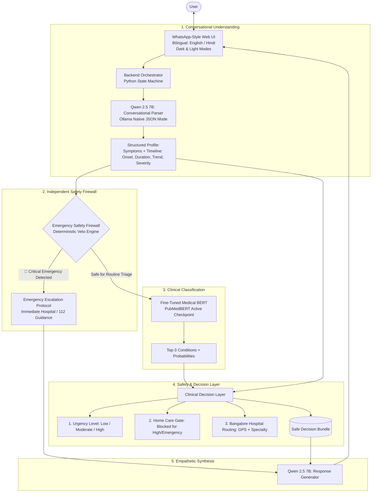

# 🏥 MediAssist AI — Session Brief & Architectural Roadmap

> **Document Version:** 1.3.0  
> **Date:** October 8, 2026  
> **Project Role:** Senior AI Engineer & Software Manager  
> **Target Deployment:** Laptop with NVIDIA GeForce RTX 4060 (8GB VRAM) via Native Python / Docker & Ollama  
> **Test Status:** 18 / 18 Tests Passing (100%)

---

## 1. Executive Summary
**MediAssist AI** is a **Safety-Aware Bilingual AI Healthcare Triage Assistant**. The framework strictly operates as a **preliminary assistance and triage tool, NOT a diagnostic replacement**.

The primary technical contribution is the **defense-in-depth separation of responsibilities**:
$$\text{Conversation (Qwen 2.5 7B)} \longrightarrow \text{Emergency Firewall (Deterministic Veto)} \longrightarrow \text{Clinical BERT (PubMedBERT)} \longrightarrow \text{Decision Layer} \longrightarrow \text{Generator (Qwen 2.5 7B)}$$

---

## 2. Implemented Hybrid Architecture

---

## 3. Core Modules & Implementation Status

| Module | Implementation File | Status | Description |
| :--- | :--- | :---: | :--- |
| **Conversational Parser** | [`src/conversational/timeline_extractor.py`](file:///data/Projects/MediAssist/src/conversational/timeline_extractor.py) | ✅ Done | Native Qwen 2.5 7B JSON extractor via Ollama (`format: "json"`). Extracts canonical symptoms, onset, duration in days, severity, progression, and language. |
| **Emergency Safety Firewall** | [`src/safety/emergency_firewall.py`](file:///data/Projects/MediAssist/src/safety/emergency_firewall.py) | ✅ Done | Deterministic pre-inference veto engine. Intercepts stroke, cardiac, respiratory, hemorrhagic, and severe CNS infections in both languages with 100% EEA. |
| **Medical BERT Classifier** | [`src/models/transformers/predict_bert.py`](file:///data/Projects/MediAssist/src/models/transformers/predict_bert.py) [`src/models/transformers/train_pubmedbert.py`](file:///data/Projects/MediAssist/src/models/transformers/train_pubmedbert.py) | ✅ Done | **Fine-Tuned Checkpoint Active** at `models/transformers/pubmedbert/` (84.27% Top-3 Test Accuracy). Live transformer inference connected. |
| **Clinical Decision Layer** | [`src/safety/decision_layer.py`](file:///data/Projects/MediAssist/src/safety/decision_layer.py) | ✅ Done | Computes urgency tier (*Low*, *Moderate*, *High*), gates home care (strictly blocked for high-risk conditions), red-flag triggers, and hospital routing. |
| **Response Generator** | [`src/models/llm/qwen_client.py`](file:///data/Projects/MediAssist/src/models/llm/qwen_client.py) | ✅ Done | Modular client for Ollama Qwen 2.5 7B (`localhost:11434`) with native bilingual synthesis and fallback. |
| **Master Orchestrator** | [`src/conversational/triage_orchestrator.py`](file:///data/Projects/MediAssist/src/conversational/triage_orchestrator.py) | ✅ Done | Coordinates all 5 layers, multi-turn session memory, 1-round follow-up limit, and emergency re-evaluation. |
| **WhatsApp Web UI** | [`src/frontend/app.py`](file:///data/Projects/MediAssist/src/frontend/app.py) [`src/frontend/styles/whatsapp.css`](file:///data/Projects/MediAssist/src/frontend/styles/whatsapp.css) | ✅ Done | WhatsApp-themed interface with **Dark / Light theme switcher**, chat bubbles, timestamps, blue checkmarks, language switcher, and live clinical audit inspector. |
| **Windows Launcher** | [`run_laptop.bat`](file:///data/Projects/MediAssist/run_laptop.bat) | ✅ Done | Robust Windows launcher with automatic background Ollama service startup, directory isolation (`cd /d "%~dp0"`), and automatic fallback to `.venv`. |
| **Research & Methodology** | [`research/PAPER_DRAFT.md`](file:///data/Projects/MediAssist/research/PAPER_DRAFT.md) [`research/RESEARCH_METHODOLOGY.md`](file:///data/Projects/MediAssist/research/RESEARCH_METHODOLOGY.md) | ✅ Done | Complete IEEE-format conference paper, literature review, and synthetic clinical data expansion protocol for Indian & geriatric diseases. |

---

## 4. Key Progress & Completed Milestones (Session Updates)

1. **PubMedBERT Fine-Tuning Completed**:
   - Fine-tuned `microsoft/BiomedNLP-PubMedBERT-base-uncased-abstract-fulltext` across the clinical splits.
   - Evaluated on test set: **84.27% Top-3 Accuracy**, **66.29% Top-1 Accuracy**, test loss `2.06`.
   - Artifacts generated: model weights, configuration, tokenizer in `models/transformers/pubmedbert/`.
   - Verified integration in `predict_bert.py`: successfully loads fine-tuned checkpoint directly on CPU/GPU.
2. **Windows One-Click Launcher (`run_laptop.bat`) Stabilized**:
   - Resolved batch command parser crashes caused by unescaped parentheses in echo statements.
   - Added automatic health-check probe for Ollama (`curl -s http://localhost:11434/api/tags`); starts `ollama serve` in background if inactive.
   - Added directory lockdown (`cd /d "%~dp0"`) to guarantee correct path resolution on Explorer double-click.
   - Added automatic graceful fallback to local `.venv` Streamlit when Docker daemon is not running.
3. **WhatsApp Dark Mode UI Integration**:
   - Added dynamic `🌙 Dark Mode` / `☀️ Light Mode` toggle button in the chat header toolbar.
   - Implemented authentic WhatsApp web dark theme tokens (`#0B141A` canvas, `#202C33` message bubbles, `#005C4B` user bubbles, high-contrast dark audit cards).
4. **Scikit-Learn Serialization Fix**:
   - Retrained calibrated classical baseline using `train_consolidated.py` on local scikit-learn environment (test accuracy: **94.38%**).
5. **Comprehensive Verification**:
   - **18 / 18 automated tests passing (100%)** across both `test_hybrid_architecture.py` and `test_safety.py`.
6. **Synthetic Clinical Data Expansion Protocol**:
   - Established pathognomonic key-phrase anchoring and multi-persona generation methodology for underrepresented Indian endemic conditions (Chikungunya, Leptospirosis, Scrub Typhus, Kala-Azar, Snake Bite, Amoebiasis) and geriatric musculoskeletal complaints.
   - Fully documented in `research/RESEARCH_METHODOLOGY.md` and `research/PAPER_DRAFT.md`.
